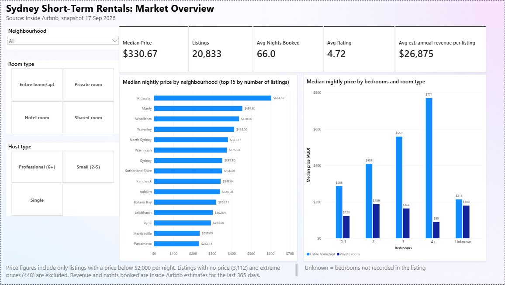

# Sydney Short-Term Rental Market Analysis (SQL Server + Power BI)

An end-to-end analytics project on the Sydney Airbnb market. Raw Inside Airbnb files are loaded into SQL Server, cleaned and modelled in SQL, then explored in a four-page Power BI report.

**Project question:** How do price, estimated revenue and scarcity vary across Sydney neighbourhoods, room types, seasons and host types?

> Snapshot: Inside Airbnb Sydney, scraped 17 Sep 2026. The calendar covers 17 Sep 2026 to 16 Sep 2027.



---

## Why this project

I have 8+ years of hotel reservations experience and I am moving into revenue management and data analytics. Hotel questions such as "what drives rate, when does demand peak, who is the competition" apply equally to short-term rentals, so this project looks at the same questions with a SQL + Power BI workflow.

## Key findings

| # | Finding | Evidence |
|---|---------|----------|
| 1 | **Price depends on size and location.** | Median nightly price is $330.67. Entire homes with 4+ bedrooms reach $771 vs $288 for 0 to 1 bedroom. Pittwater ($604) and Manly ($455) lead the top 15 neighbourhoods. |
| 2 | **Demand is seasonal.** | Unavailability is lowest in Nov 2026 (44.3%), peaks at 66.9% on 31 Dec 2026, and builds to about 61% by Aug 2027. Reviews peak from Oct to Dec. |
| 3 | **Professional hosts dominate supply.** | Hosts with 6+ listings run 43% of listings (8,895 of 20,833) but have the lowest rating (4.61 vs 4.83 for single-listing hosts) and the lowest STRA registration (69.5% vs 79.3%). |
| 4 | **Higher price does not mean more booked nights.** | Among the top 15 neighbourhoods, Pittwater has the highest median price but the lowest estimated nights booked; Sydney books the most. This is descriptive, not causal. |

**Implications for revenue managers:** raise rates ahead of the New Year peak, use the shoulder periods (Nov and Jan to Feb) for promotions and longer stays, and benchmark against the same neighbourhood and room type rather than the city average.

## Tech stack

- **SQL Server Express** and **SSMS** (T-SQL: BULK INSERT, window and aggregate functions, `PERCENTILE_CONT`, views)
- **Power BI Desktop** (data model, DAX, report design)
- Source: [Inside Airbnb](https://insideairbnb.com/get-the-data/), Sydney

## Architecture

Data moves through three layers:

```
CSV files ──> stg (raw, all text) ──> dbo (clean, typed star schema) ──> rpt (views and aggregates) ──> Power BI
```

| Layer | Schema | Purpose |
|-------|--------|---------|
| Staging | `stg` | Raw data loaded as text so no row fails on import. |
| Clean | `dbo` | Typed columns, derived fields and data-quality flags. `dim_listing`, `fact_calendar`, `fact_review`. |
| Reporting | `rpt` | Only what Power BI needs: 4 dimension views and 2 pre-aggregated tables. |

Power BI imports six `rpt` objects (plus a generated date table), so the 7.6M-row calendar never enters the report. The calendar is pre-aggregated to 89,790 rows and reviews to 22,857 rows.

### Data model

- Dimensions: `Neighbourhood`, `RoomType`, `HostType`, `DimDate` (built in DAX), and `Listing` (the listing-level table).
- Facts: `Availability` (daily listing-days and unavailable days by neighbourhood, room type and host type) and `ReviewsMonthly`.
- Eleven many-to-one relationships, single direction. Key columns are hidden in fact tables and `Month` is sorted by `Month No`.
- All measures live in a dedicated `_Measures` table.

## Repository structure

```
├── README.md
├── sql/
│   ├── 01_setup_and_load.sql        # create DB, staging tables, BULK INSERT, row-count checks
│   ├── 02_clean_data.sql            # dbo.dim_listing, fact_calendar, fact_review + validation checks
│   ├── 03_analysis_queries.sql      # exploratory analysis (Q1 to Q6)
│   ├── 04_reporting_layer.sql       # rpt views (dimensions)
│   └── 04b_reporting_aggs_fix.sql   # rpt aggregate tables for Power BI
├── powerbi/
│   ├── Sydney_Airbnb_Dashboard.pbix
│   └── 05_dax_measures.txt          # all DAX measures and the DimDate table
└── images/                          # dashboard screenshots
```

The raw CSV files are not included because of their size and the source's terms; download them from Inside Airbnb.

## How to reproduce

1. Download `listings.csv`, `calendar.csv`, `reviews.csv` (detailed files) for Sydney from Inside Airbnb. Remove the long text columns from `listings.csv` and `reviews.csv` to produce `listings_slim.csv` and `reviews_slim.csv` (the load script expects the slim layout).
2. Put the three CSVs in `C:\data\airbnb\` (a folder the SQL Server service account can read).
3. Run the SQL scripts in order: `01`, `02`, `03` (optional), `04`, `04b`.
4. Open the `.pbix`, point the data source to your SQL Server instance, and refresh.

Expected row counts after loading: **20,833** listings, **7,604,045** calendar rows, **829,163** reviews.

## Data cleaning and assumptions

- **Staging as text.** Everything is loaded as `NVARCHAR` first, then converted with `TRY_CAST(NULLIF(...))`, because `TRY_CAST('')` returns 0 for numbers and would silently create fake zeros.
- **Price rule.** Only listings with a price below $2,000 per night are used for price figures (`price_flag = 'OK'`). Missing prices (3,112) and extreme prices (448) are flagged, not deleted, so counts still reconcile. The calendar file in this snapshot has no price column, so price comes from the listings table.
- **Host type** is based on the host's total number of listings: Single (1), Small (2 to 5), Professional (6+).
- **Licence status:** STRA registered (15,517), Exempt (4,086), Missing (1,230).
- **"Unavailable"** means booked or blocked by the host. Far-future unavailability may reflect host calendars rather than demand.
- **Partial months.** Sep 2026 and Sep 2027 contain only 14 and 16 days of calendar data.
- **Estimates.** Estimated nights booked (`estimated_occupancy_l365d`, a number of nights, not a percentage) and estimated revenue are Inside Airbnb model estimates for the last 365 days.
- **Reviews lag stays,** and 2026 reviews only run to 17 Sep, so they are used for seasonality (2023 to 2025), not for recent demand.

## Performance note

The first version of the reporting aggregation grouped by long text columns and stalled on SQL Server Express's 1 GB memory limit (`RESOURCE_SEMAPHORE` memory-grant wait). The fix was to group by integer keys in temp tables, join the names back afterwards and cap the memory grant with `OPTION (MAX_GRANT_PERCENT = 10)`. This is documented in `04b_reporting_aggs_fix.sql`.

## Validation

Report totals were reconciled with SQL results at each step:

| Check | SQL | Power BI |
|-------|-----|----------|
| Listings | 20,833 | 20,833 |
| Median nightly price | 330.67 | $330.67 |
| Average estimated revenue per listing | 26,875 | $26,875 |
| Total reviews | 829,163 | 829,163 |
| Unavailable listing-days | 3,958,059 of 7,604,045 (52.1%) | 52.1% |
| STRA registered share | 74.5% | 74.5% |

## Limitations

- Estimated nights and revenue are modelled, not actual bookings.
- A single snapshot cannot show year-on-year trends in prices.
- Calendar availability does not separate guest bookings from host blocks.
- Findings are descriptive and should not be read as causal.

## Author

**Chloe Nguyen**, Sydney NSW
Power BI Data Analyst Associate · IBM Data Analyst Professional
[LinkedIn](www.linkedin.com/in/chloe-nguyen-990856166) · [GitHub](https://github.com/ngochuyen27196)

*Data: Inside Airbnb. This project is independent and is not affiliated with Airbnb.*
